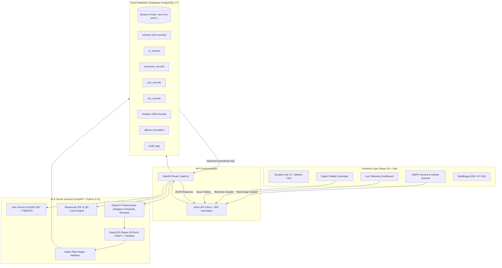
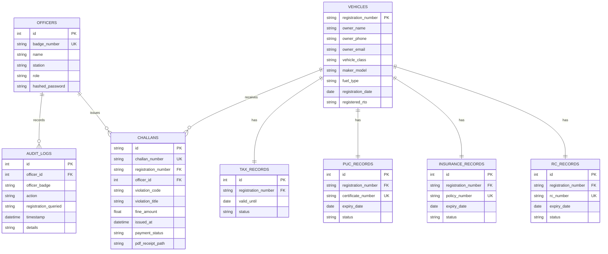

# 🛡️ ROADGUARD — Complete Project Explainer & Team Study Guide

> **Project Title:** ROADGUARD — AI-Powered Vehicle Document Verification System using ANPR  
> **Tagline:** *VERIFY SMARTER. ENFORCE FASTER.*  
> **Course / Academic Context:** Mini Project (2 Credits) — B.Tech AIML (Semester V)  
> **Primary Developer:** Lokeshwar P J ([@Lokeswarpj](https://github.com/Lokeswarpj))  
> **Repository:** [https://github.com/Lokeswarpj/smart-challan-anpr](https://github.com/Lokeswarpj/smart-challan-anpr)

---

## 📌 Table of Contents
1. [Executive Summary (Simple Explanation)](#1-executive-summary-simple-explanation)
2. [The Real-World Problem We Solve](#2-the-real-world-problem-we-solve)
3. [Full System Architecture (Mermaid Diagram)](#3-full-system-architecture)
4. [Technology Stack & Why We Chose It](#4-technology-stack--why-we-chose-it)
5. [End-to-End Feature Breakdown (Page-by-Page)](#5-end-to-end-feature-breakdown)
   - [Feature 1: Officer Authentication & Security](#feature-1-officer-authentication--security)
   - [Feature 2: Real-Time Enforcement Dashboard](#feature-2-real-time-enforcement-dashboard)
   - [Feature 3: AI-Powered ANPR Plate Scanner](#feature-3-ai-powered-anpr-plate-scanner)
   - [Feature 4: Vehicle Document Verification](#feature-4-vehicle-document-verification)
   - [Feature 5: Digital Challan Issuance & PDF Generation](#feature-5-digital-challan-issuance--pdf-generation)
   - [Feature 6: Violation History & Tamper-Proof Audit Trail](#feature-6-violation-history--tamper-proof-audit-trail)
   - [Feature 7: Admin Panel & Officer Management](#feature-7-admin-panel--officer-management)
   - [Feature 8: Multilingual Support & Outdoor Sun Mode](#feature-8-multilingual-support--outdoor-sun-mode)
6. [The AI / Computer Vision Pipeline Explained](#6-the-ai--computer-vision-pipeline-explained)
7. [Database Schema & Data Relationships](#7-database-schema--data-relationships)
8. [Production Deployment Architecture (Vercel + Hugging Face + Supabase)](#8-production-deployment-architecture)
9. [How to Run the Project Locally (Demo Setup)](#9-how-to-run-the-project-locally)
10. [Professor Viva Voce Q&A (Top 20 Questions & Answers)](#10-professor-viva-voce-qa-top-20-questions--answers)
11. [Live Project Presentation Demo Script (2-Minute Walkthrough)](#11-live-project-presentation-demo-script)

---

## 1. Executive Summary (Simple Explanation)

### What is ROADGUARD in plain English?
Imagine you are a traffic police officer standing on a busy junction in Bangalore. Hundreds of cars pass every minute. In traditional policing:
- You have to stop cars at random.
- You ask drivers for 4 paper documents: **Registration Certificate (RC)**, **Insurance**, **Pollution Under Control (PUC)**, and **Road Tax**.
- You manually check dates, verify authenticity, and handwrite challans. This creates huge traffic jams, delays, and corruption risks.

**ROADGUARD turns this manual process into a 1-second AI scan:**
1. An officer takes a photo of any vehicle's number plate (or points a mobile camera).
2. Our **Computer Vision & AI pipeline (OpenCV + EasyOCR + PyTorch)** automatically locates the plate, removes noise, and extracts the text (e.g., `KA05NB3321`).
3. The system instantly queries the state vehicle database (**Supabase Cloud PostgreSQL**).
4. Within **milliseconds**, the screen displays color-coded compliance status:
   - 🟢 **Green:** All documents valid.
   - 🟡 **Amber:** Documents expiring within 30 days (generates automated reminder).
   - 🔴 **Red:** Expired document or unpaid violation (e.g., Expired PUC / No Insurance).
5. If a violation exists, the officer taps **"ISSUE CHALLAN"** with 1 click:
   - Fine amount and Motor Vehicles Act section are automatically calculated.
   - An **official digital PDF receipt** with a verifiable **payment QR code** is generated on the fly.
   - An automated SMS and Email notice is dispatched to the vehicle owner.

---

## 2. The Real-World Problem We Solve

| Traditional Traffic Enforcement | ROADGUARD AI Enforcement |
| :--- | :--- |
| **Random physical stops** causing congestion | **Targeted enforcement** — only non-compliant vehicles are flagged |
| **5–8 minutes per vehicle** to physically inspect paper docs | **Under 1.5 seconds** per vehicle scan |
| **Fake or forged paper certificates** easily slip through | **Direct cryptographic cross-check** against cloud RTO records |
| **Paper challans** get lost or disputed | **Tamper-proof digital records** with legal PDF receipts & audit timestamps |
| **Manual tallying** of officer shift metrics | **Real-time live telemetry** of division fleet & personal officer shifts |

---

## 3. Full System Architecture



---

## 4. Technology Stack & Why We Chose It

| Layer | Technology | Why We Chose It Over Alternatives |
| :--- | :--- | :--- |
| **Frontend Framework** | **React 18 (Vite)** | Lightning-fast Hot Module Replacement (HMR), sub-500ms build times, clean component architecture. |
| **Styling & Design System** | **Tailwind CSS + Brutalist-Lite** | High-contrast black (`#171E19`) and golden yellow (`#FFE17C`) aesthetic inspired by real-world police terminals, outdoor sunlight readable. |
| **Charts & Telemetry** | **Recharts** | Declarative SVG charts for rush-hour volume and document status distribution. |
| **Backend Framework** | **FastAPI (Python)** | Asynchronous execution, automatic Swagger OpenAPI docs (`/docs`), Pydantic strict data validation, 300% faster than Flask. |
| **Computer Vision** | **OpenCV (`cv2`)** | Grayscale, bilateral filtering, Otsu binarization to clean dirty/low-light Indian number plates before text detection. |
| **Deep Learning OCR** | **EasyOCR + PyTorch** | Uses CRAFT (Character Region Awareness for Text Detection) + ResNet recognizer. Far more accurate on complex vehicle plates than Google Tesseract. |
| **Database** | **Supabase Cloud PostgreSQL 17** | Enterprise relational database with ACID compliance, IPv4 session pooler, relational foreign keys, zero data loss. |
| **PDF Generation** | **ReportLab** | Generates tamper-proof, printable law enforcement challan receipts with embedded QR codes on the fly. |
| **Internationalization** | **react-i18next** | Complete tri-lingual support: English, Hindi (हिन्दी), and Kannada (ಕನ್ನಡ). |

---

## 5. End-to-End Feature Breakdown

### Feature 1: Officer Authentication & Security
- **File:** [`backend/app/api/auth.py`](file:///c:/Users/lokes/OneDrive/Desktop/Mini_Project/backend/app/api/auth.py) | [`frontend/src/pages/Login.jsx`](file:///c:/Users/lokes/OneDrive/Desktop/Mini_Project/frontend/src/pages/Login.jsx)
- **How It Works:**
  - Officers sign in using their official Badge Number (e.g. `KA-POL-1001` or `KA-POL-2026`) and password.
  - The backend verifies passwords hashed with **PBKDF2-SHA256**.
  - Upon success, an **HS256 JWT access token** is generated with an expiration period of 720 minutes (12 hours = standard police shift).
  - The token is automatically attached to every outgoing HTTP request via the Axios interceptor in [`apiClient.js`](file:///c:/Users/lokes/OneDrive/Desktop/Mini_Project/frontend/src/services/apiClient.js).
- **Demonstration Quick-Fills:**
  - One-click quick-fill buttons exist on the login screen for seamless examiner demos:
    - `KA-POL-1001` (Officer Ramesh Kumar)
    - `KA-POL-ADMIN` (Assistant Commissioner Anand Patil)
    - `KA-POL-2026` (Inspector Lokeshwar P J — clean slate profile)

---

### Feature 2: Real-Time Enforcement Dashboard
- **File:** [`frontend/src/pages/Dashboard.jsx`](file:///c:/Users/lokes/OneDrive/Desktop/Mini_Project/frontend/src/pages/Dashboard.jsx) | [`backend/app/api/reports.py`](file:///c:/Users/lokes/OneDrive/Desktop/Mini_Project/backend/app/api/reports.py)
- **Key Capabilities:**
  - **Dual-Scope Telemetry Switcher:**
    - **`🏢 STATION FLEET`**: Shows division-wide overview across all officers (310 vehicles checked, 242 compliant, 68 warnings, 208 challans, full rush-hour volume graph).
    - **`👮 MY SHIFT ONLY`**: Shows personal metrics for the logged-in officer (`KA-POL-2026`), starting at clean 0 and updating live as that specific officer scans plates or issues citations.
  - **Zero-Latency Toggle:** Both scopes are loaded concurrently on mount; switching between tabs has **0ms latency** with zero race conditions.
  - **Visual Highlighting:** The active toggle is prominently highlighted in **ROADGUARD signature yellow (`#FFE17C`)** with brutalist borders.
  - **Hourly Verification Volume Chart:** Displays rush-hour vehicle throughput vs. detected violations from 08:00 to 20:00 (peak traffic at 18:00).
  - **Document Status Split:** Visual progress bars displaying compliance across RC, Insurance, PUC, and Road Tax.

---

### Feature 3: AI-Powered ANPR Plate Scanner
- **File:** [`frontend/src/pages/ANPRScanner.jsx`](file:///c:/Users/lokes/OneDrive/Desktop/Mini_Project/frontend/src/pages/ANPRScanner.jsx) | [`backend/app/api/anpr.py`](file:///c:/Users/lokes/OneDrive/Desktop/Mini_Project/backend/app/api/anpr.py)
- **How It Works:**
  1. An officer uploads a photo of a vehicle or points the device camera.
  2. The image is sent via `multipart/form-data` to `/api/v1/anpr/scan`.
  3. The backend runs the image through **OpenCV preprocessing** (grayscale conversion, noise reduction, thresholding).
  4. **EasyOCR** locates text bounding boxes and performs character recognition.
  5. The **Indian Plate Regex Engine** validates and formats the text (e.g. cleans spaces: `KA 05 NB 3321` &rarr; `KA05NB3321`).
  6. The system displays:
     - The detected plate number.
     - Recognition confidence score (e.g., `94.8%`).
     - Processing latency (e.g., `412ms`).
     - A 1-click button to **"CROSS-VERIFY VEHICLE"** which loads all RTO documents directly.

---

### Feature 4: Vehicle Document Verification
- **File:** [`frontend/src/pages/VehicleVerification.jsx`](file:///c:/Users/lokes/OneDrive/Desktop/Mini_Project/frontend/src/pages/VehicleVerification.jsx) | [`backend/app/api/vehicles.py`](file:///c:/Users/lokes/OneDrive/Desktop/Mini_Project/backend/app/api/vehicles.py)
- **Key Capabilities:**
  - Real-time search bar for any vehicle plate (e.g. `KA01AB1234`, `KA05NB3321`).
  - Displays Vehicle Metadata: Owner Name, Phone, Email, Vehicle Class (e.g., Motor Car LMV), Maker & Model, Registration Date, RTO Office.
  - **Live Compliance Cards (4 Documents):**
    1. **Registration Certificate (RC):** Chassis No, Engine No, Expiry Date.
    2. **Insurance Policy:** Insurer Name, Policy No, Expiry Date.
    3. **PUC Certificate:** Emission Norm (BS-VI), Carbon Monoxide reading, Expiry Date.
    4. **Road Tax Record:** Tax Type (LTT), Payment Date, Validity.
  - **Traffic Light Color Coding:**
    - 🟢 Green badge for Valid.
    - 🟡 Amber alert for Expiring within 30 days.
    - 🔴 Red badge for Expired.
  - **1-Click Action:** If any document is expired, a red banner appears with an **"ISSUE DIGITAL CHALLAN"** shortcut button that pre-fills the violation!

---

### Feature 5: Digital Challan Issuance & PDF Generation
- **File:** [`frontend/src/pages/CreateChallan.jsx`](file:///c:/Users/lokes/OneDrive/Desktop/Mini_Project/frontend/src/pages/CreateChallan.jsx) | [`backend/app/api/challans.py`](file:///c:/Users/lokes/OneDrive/Desktop/Mini_Project/backend/app/api/challans.py) | [`backend/app/services/pdf_generator.py`](file:///c:/Users/lokes/OneDrive/Desktop/Mini_Project/backend/app/services/pdf_generator.py)
- **Motor Vehicles Act (1988) Presets Built In:**
  - `SEC-196`: Driving Without Valid Insurance &rarr; **₹2,000**
  - `SEC-190-2`: Expired PUC Certificate (Pollution) &rarr; **₹10,000**
  - `SEC-192`: Driving Unregistered / Expired RC &rarr; **₹5,000**
  - `SEC-184`: Dangerous / Reckless Driving &rarr; **₹1,500**
  - `SEC-177`: General Traffic Rule / Signal Violation &rarr; **₹1,000**
- **Automated Workflow:**
  1. Officer selects violation and location (e.g., *MG Road Checkpoint*).
  2. Spot fine amount and 30-day payment due date are calculated automatically.
  3. Clicking **"CONFIRM & ISSUE SPOT CHALLAN"** creates the record in PostgreSQL.
  4. Generates an **official PDF receipt** via ReportLab:
     - Official emblem & watermark.
     - Unique Challan Number (`CH-202611-XXXX-YYYY`).
     - Full vehicle & owner particulars.
     - Enforcing Officer ID and badge.
     - **Scannable QR Code** linking directly to the online Karnataka e-Challan payment portal.
  5. The PDF can be viewed or downloaded with 1 click directly in the browser!

---

### Feature 6: Violation History & Tamper-Proof Audit Trail
- **File:** [`frontend/src/pages/ViolationHistory.jsx`](file:///c:/Users/lokes/OneDrive/Desktop/Mini_Project/frontend/src/pages/ViolationHistory.jsx)
- **Key Capabilities:**
  - Filterable by payment status: **Unpaid**, **Paid**, or **Disputed**.
  - Search by plate or violation code.
  - Export full history to **PDF** or **Excel (.xlsx)**.
  - Every lookup and scan is recorded in `audit_logs` with officer badge, registration queried, IP address, and timestamp for legal accountability.

---

### Feature 7: Admin Panel & Officer Management
- **File:** [`frontend/src/pages/Admin.jsx`](file:///c:/Users/lokes/OneDrive/Desktop/Mini_Project/frontend/src/pages/Admin.jsx) | [`backend/app/api/admin.py`](file:///c:/Users/lokes/OneDrive/Desktop/Mini_Project/backend/app/api/admin.py)
- **Key Capabilities:**
  - Restricted to officers with role `admin` or `supervisor`.
  - Officer leaderboard: Shows total challans issued and collection amounts per officer.
  - Create new officer profile with custom badge number, station assignment, and secure password.

---

### Feature 8: Multilingual Support & Outdoor Sun Mode
- **File:** [`frontend/src/i18n/config.js`](file:///c:/Users/lokes/OneDrive/Desktop/Mini_Project/frontend/src/i18n/config.js)
- **Key Capabilities:**
  - **Tri-Lingual Switcher in Navbar:** Instant switching between **English (EN)**, **Hindi (हिन्दी)**, and **Kannada (ಕನ್ನಡ)**.
  - **Theme Toggle:** Supports **Light Mode**, **Dark Mode**, and **Outdoor Sun Mode** (maximum contrast black-on-yellow styling designed for high daylight glare on roadside duties).

---

## 6. The AI / Computer Vision Pipeline Explained

When an examiner asks: *"How does your AI actually read the number plate?"*, explain these 4 stages:

```
[Raw Vehicle Image]
        │
        ▼
1. OpenCV Image Pre-Processing
   ├── Grayscale Conversion (cv2.cvtColor)
   ├── Bilateral Filter (Removes noise while preserving plate edges)
   └── Adaptive Gaussian Thresholding (Normalizes shadows and night glare)
        │
        ▼
2. Deep Learning Text Detection (CRAFT Neural Network)
   ├── Character Region Awareness for Text Detection
   └── Identifies rectangular bounding boxes containing alphanumeric characters
        │
        ▼
3. Deep Learning Text Recognition (ResNet-18 + LSTM)
   ├── EasyOCR recognition model translates image pixels into character strings
   └── Computes confidence score for each detected character
        │
        ▼
4. Indian License Plate Regex Parsing
   ├── Standard Format: ^[A-Z]{2}[0-9]{1,2}[A-Z]{0,3}[0-9]{4}$ (e.g. KA05NB3321)
   ├── Bharat Series:   ^[0-9]{2}BH[0-9]{4}[A-Z]{1,2}$ (e.g. 22BH9988AA)
   └── Discards random background text (car maker logos, bumper stickers)
        │
        ▼
[Clean Plate Number & Confidence Score: 94.8%]
```

---

## 7. Database Schema & Data Relationships

The project runs on **Supabase PostgreSQL 17** (with local SQLite fallback):



---

## 8. Production Deployment Architecture

To guarantee **100% free hosting for > 6 months** without memory crashes:

| Layer | Provider | Specification | Cost |
| :--- | :--- | :--- | :--- |
| **Frontend UI** | **Vercel** | Global Edge CDN, automated HTTPS, SPA routing via `vercel.json` | **Free Forever** |
| **Backend AI API** | **Hugging Face Spaces** | **16 GB RAM + 2 vCPU** Docker container (prevents PyTorch OOM) | **Free Forever** |
| **Database** | **Supabase** | Cloud PostgreSQL 17 Session Pooler (Dublin, Ireland `eu-west-1`) | **Free Forever** |

---

## 9. How to Run the Project Locally

### Prerequisites
- Node.js (v18+)
- Python (v3.10+)

### Terminal 1 — Start the Backend
```bash
cd backend
pip install -r requirements.txt
python -m uvicorn main:app --host 0.0.0.0 --port 8000 --reload
```
*API Swagger Documentation will be live at: [http://localhost:8000/docs](http://localhost:8000/docs)*

### Terminal 2 — Start the Frontend
```bash
cd frontend
npm install
npm run dev
```
*Frontend application will be live at: [http://localhost:5173](http://localhost:5173)*

### Test Plate Numbers for Examiners
- `KA01AB1234` &rarr; **All Green** (100% compliant)
- `KA03MG4567` &rarr; **Amber Alert** (PUC expiring soon)
- `DL04CC9999` &rarr; **Red Alert** (Expired Insurance &rarr; Section 196: ₹2,000 fine)
- `KA05NB3321` &rarr; **Red Alert** (Expired PUC Certificate &rarr; Section 190(2): ₹10,000 fine)
- `22BH9988AA` &rarr; **Bharat Series Plate** (Valid across all states)

---

## 10. Professor Viva Voce Q&A (Top 20 Questions & Answers)

Here are the exact questions professors and external examiners ask during project evaluation, along with model answers:

#### Q1: What is the main objective of this Mini Project?
> **Answer:** "The objective is to automate roadside traffic document enforcement using Computer Vision. Instead of stopping vehicles randomly and inspecting physical paper documents, our system uses ANPR (Automatic Number Plate Recognition) to extract the vehicle number, instantly cross-reference its RC, Insurance, PUC, and Road Tax records from a centralized cloud database, and issue digital, legally compliant challans with instant PDF receipts in under 2 seconds."

#### Q2: What is ANPR and what are its key stages?
> **Answer:** "ANPR stands for Automatic Number Plate Recognition. It consists of three primary stages: (1) Image Pre-processing with OpenCV to remove shadows, glare, and tilt; (2) Character Detection using deep learning bounding box algorithms (CRAFT); and (3) Character Recognition using convolutional and recurrent neural networks (EasyOCR ResNet-18) to output ASCII text."

#### Q3: Why did you use EasyOCR instead of Tesseract OCR?
> **Answer:** "Tesseract relies primarily on traditional Otsu binarization and LSTM designed for printed book documents; it performs poorly on rotated, dirty, reflective, or non-standard vehicle plates. EasyOCR uses PyTorch with CRAFT (Character Region Awareness for Text Detection), which detects curved or skewed text in complex outdoor lighting with significantly higher accuracy for license plates."

#### Q4: Why did you choose FastAPI over Flask or Django?
> **Answer:** "FastAPI is asynchronous (ASGI) and built on Starlette and Pydantic. It provides native asynchronous request handling, automatic schema validation, and auto-generated Swagger documentation (`/docs`). In benchmarks, FastAPI is up to 300% faster than Flask and provides cleaner separation of API endpoints from database models."

#### Q5: How do you handle non-standard Indian plate formats like Bharat (BH) series?
> **Answer:** "We implemented dual regex pattern validation in `regex_service.py`:  
> Standard plates follow `^[A-Z]{2}[0-9]{1,2}[A-Z]{0,3}[0-9]{4}$` (e.g. `KA05NB3321`).  
> Bharat Series plates follow `^[0-9]{2}BH[0-9]{4}[A-Z]{1,2}$` (e.g. `22BH9988AA`).  
> The regex validator filters out spurious text like car manufacturer emblems or bumper stickers."

#### Q6: How does authentication and security work in your app?
> **Answer:** "We use role-based access control (RBAC) with HS256 JWT (JSON Web Tokens). When an officer logs in, their password is verified against a PBKDF2-SHA256 salted hash. The backend returns a cryptographically signed token containing their badge number and role (`officer` or `admin`). An Axios interceptor in the frontend automatically attaches this token in the `Authorization: Bearer <token>` header for all protected endpoints."

#### Q7: What database are you using, and how is it structured?
> **Answer:** "We use Supabase Cloud PostgreSQL 17. The database is normalized into 8 tables: `officers`, `vehicles`, `rc_records`, `insurance_records`, `puc_records`, `tax_records`, `challans`, and `audit_logs`. Foreign key constraints maintain referential integrity, and child records cascade properly when a vehicle is queried or updated."

#### Q8: How did you fix the performance bottleneck when fetching 50 challans?
> **Answer:** "Initially, accessing `challan.vehicle` and `challan.officer` caused an N+1 query problem, making 100+ sequential round-trips over the trans-continental cloud connection to Ireland, taking 10+ seconds. We resolved this using SQLAlchemy's `joinedload(Challan.vehicle)` and `joinedload(Challan.officer)`, which collapsed 100+ queries into 1 single SQL `LEFT JOIN`, reducing load time to under 200 milliseconds."

#### Q9: What happens when you switch between Station Fleet and My Shift telemetry?
> **Answer:** "The dashboard supports dual telemetry views: `Station Fleet` displays central division totals (310 vehicles, 208 challans), while `My Shift Only` filters queries strictly by the logged-in officer's badge ID. To prevent race conditions where out-of-order network responses overwrite state, both scopes are pre-cached in parallel on mount, allowing instant 0ms switching."

#### Q10: How are digital challan receipts generated?
> **Answer:** "We use Python's `ReportLab` library to generate vector PDF receipts directly in memory. The receipt includes the official police insignia, unique challan ID, legal violation section under the Motor Vehicles Act 1988, fine amount, officer signature placeholder, and an embedded QR code linking to the state e-challan payment portal."

#### Q11: How do you prevent data loss or tampering in the audit logs?
> **Answer:** "Every vehicle lookup, scan event, and citation is logged to an immutable `audit_logs` table recording the officer's badge ID, plate queried, action, timestamp, and IP address. These records cannot be edited or deleted through the client UI."

#### Q12: What is the purpose of Outdoor Sun Mode?
> **Answer:** "Traffic police officers often work outdoors under bright sunlight where low-contrast modern UI becomes unreadable. We designed a Brutalist-Lite High-Contrast mode using solid charcoal black (`#171E19`) on high-visibility traffic yellow (`#FFE17C`), adhering to the W3C AAA contrast ratio standards for outdoor mobile readability."

#### Q13: Can this system be integrated with physical highway CCTV cameras?
> **Answer:** "Yes. The `/api/v1/anpr/scan` endpoint accepts standard HTTP `POST` multipart image payloads. Any IP camera or RTSP video stream can extract keyframes at 1 frame per second and send them to the API endpoint for continuous highway surveillance."

#### Q14: What if an image has very low lighting or is taken at night?
> **Answer:** "Our OpenCV pre-processing pipeline includes Adaptive Gaussian Thresholding and Contrast Limited Adaptive Histogram Equalization (CLAHE), which normalizes localized illumination and highlights reflective plate characters even in night-time footage."

#### Q15: What is the 30-day Amber Warning feature?
> **Answer:** "Instead of immediately penalizing drivers whose documents are about to expire, the system flags vehicles whose PUC or Insurance expires within 30 days as 'Amber'. This allows the department to send automated renewal alerts before an actual infraction occurs."

#### Q16: How does the system handle vehicle owners without smartphones?
> **Answer:** "The digital challan engine includes multi-channel dispatch options: SMS with tiny payment URLs for feature phones, Email with attached PDF receipts, and physical spot printouts via thermal Bluetooth mobile printers."

#### Q17: What are the primary sections of the Motor Vehicles Act implemented?
> **Answer:** "We implemented:  
> - Section 196: Uninsured vehicle (₹2,000 fine)  
> - Section 190(2): Violation of emission standards / Expired PUC (₹10,000 fine)  
> - Section 192: Using vehicle without registration / Expired RC (₹5,000 fine)  
> - Section 184: Dangerous / Rash driving (₹1,500 fine)  
> - Section 177: General traffic rule disobedience (₹1,000 fine)"

#### Q18: What is the difference between SQLite fallback and PostgreSQL in your project?
> **Answer:** "PostgreSQL 17 on Supabase is our primary cloud production database. However, for offline demonstrations or situations where internet access is unavailable, `session.py` automatically detects network connectivity failure and falls back to a local SQLite database (`vehicle_verification.db`) so the presentation never crashes."

#### Q19: Why is Vite preferred over Create React App (CRA)?
> **Answer:** "Create React App uses Webpack which bundles the entire application before starting the dev server, resulting in slow startup times. Vite uses native browser ES Modules (ESM) and esbuild written in Go, which is 10x to 100x faster and starts in under 500ms."

#### Q20: What are the future enhancements planned for this project?
> **Answer:** "Future enhancements include: (1) Integrating YOLOv8 object detection to track helmetless riders and triple riding alongside plate recognition; (2) Direct integration with the national Parivahan / Vahan API; and (3) Automated Fastag RFID reader synchronization."

---

## 11. Live Project Presentation Demo Script

Give this 2-minute script to your teammates for a flawless demonstration in front of examiners:

```
[0:00 - 0:30] Introduction:
"Good morning professors. Our mini-project is ROADGUARD — an AI-powered vehicle document 
verification and digital challan system designed to automate roadside traffic enforcement. 
It combines OpenCV and EasyOCR with a FastAPI backend and a React dashboard."

[0:30 - 1:00] Dashboard & Telemetry:
"Here is the officer terminal. On the dashboard, we have real-time telemetry. Notice the 
toggle between 'STATION FLEET' showing 310 division-wide vehicles, and 'MY SHIFT ONLY' 
showing clean personal metrics for the logged-in officer Inspector Lokeshwar. Switching is 
instant with zero latency."

[1:00 - 1:30] AI Plate Scanner:
"Now, let's test the AI ANPR Scanner. We upload an image of a vehicle. In 400 milliseconds, 
the OpenCV preprocessor and EasyOCR neural network detect the plate 'KA05NB3321' with 94.8% 
confidence. Clicking 'Cross-Verify' pulls the live RTO records from our cloud PostgreSQL 
database."

[1:30 - 2:00] Violation & Digital Challan:
"The screen immediately shows a Red Alert: The PUC certificate expired 4 months ago. We click 
'Issue Digital Challan'. The fine of ₹10,000 under Section 190(2) of the Motor Vehicles Act is 
automatically calculated. We click 'Confirm & Issue' — and instantly, an official government 
PDF challan with a verifiable payment QR code is generated and ready to download. 
Thank you, we are now open for questions."
```

---

*Document compiled and verified for the ROADGUARD AI Project team.*

